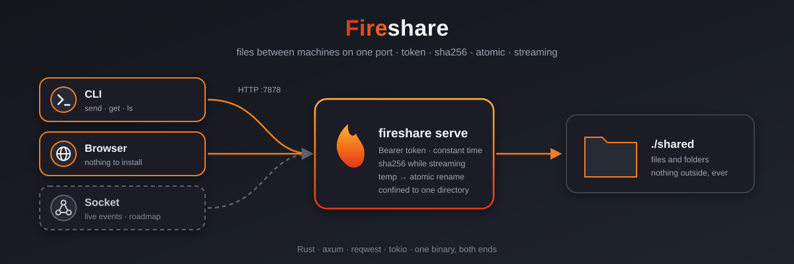
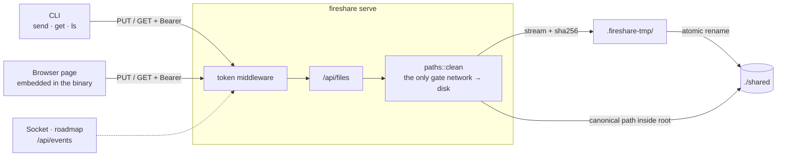
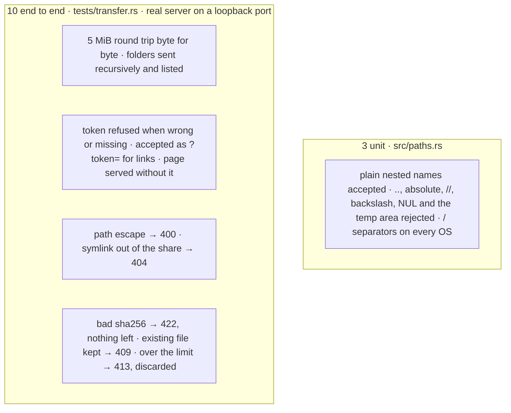

<p align="center">
  
</p>

# 🔥 Fireshare


**Author:** [Jefferson Marchetti](mailto:jeffersonm.ferreira@gmail.com)



## Overview

Fireshare moves files between machines over plain HTTP on one port. A
single binary is both ends:
- `fireshare serve` shares a directory.
- The other machine uses the `fireshare` CLI, or **just a browser**. The browser route needs nothing installed, which is the point on a locked-down machine.

Every request carries a shared token. Every upload is checked by SHA-256
while it streams and lands atomically, so a broken transfer never leaves
a half-written file. Paths cannot leave the shared directory.

The code is cut to grow into a product with three faces over one core:
- the CLI and the browser page, which exist today;
- a live-events socket, a richer interface, TLS pairing and resumable uploads, which are on the [roadmap](#roadmap).

## Features

- **Two clients today, one protocol.**
  - The browser page at `/` does drag and drop, whole-folder upload, progress and download links.
  - The CLI does `send` (files and folders, recursively), `get` (one file or `--all`) and `ls`.
- **Token on every call.**
  - `Authorization: Bearer`, or `?token=` for browser links, compared in constant time.
  - `serve` generates and prints one when none is given.
- **Integrity.**
  - The CLI sends the SHA-256 with each upload; the server hashes while streaming and refuses a mismatch with `422`.
  - Downloads carry the server's SHA-256, and the CLI checks it.
- **Atomic writes.**
  - Uploads land in `.fireshare-tmp/` and are renamed into place; downloads use a `.part` file.
  - Existing files are kept unless `--overwrite` is given (`409`).
- **Confined.**
  - Remote paths are plain relative names only: no `..`, absolute paths, backslashes or NUL.
  - A symlink pointing out of the share is not served (`404`).
- **Streaming end to end.**
  - Memory stays flat whatever the file size.
  - Uploads are bounded by `--max-mib` (default 20 GiB): above it the server answers `413` and discards the file.
- **Everywhere.**
  - Universal macOS binary (arm64 + x86_64) for any Mac.
  - Static Linux server image `FROM scratch`.
  - Every flag also reads a `FIRESHARE_*` variable.

## Architecture



| Route | Auth | What it does |
|---|---|---|
| `GET /` | no | Browser page |
| `GET /health` | no | `ok` |
| `GET /api/files` | token | Lists every shared file (`path`, `size`, `modified`) |
| `GET /api/files/{path}` | token | Streams one file, with `x-content-sha256` |
| `PUT /api/files/{path}` | token | Streams one file in; `?overwrite=true` to replace |

Status codes, guarantees and known limits are in
[`docs/design.md`](./docs/design.md) (in Portuguese).

## Requirements

- Rust 1.85+ (edition 2024); built and measured with 1.97.1.
- macOS or Linux.
- Docker, optional, for the server image.

## Running it

**Machine A shares a directory:**

```bash
make serve TOKEN=my-token          # same as: fireshare serve --dir ./shared --port 7878 --token my-token
```

```text
🔥 fireshare compartilhando ./shared
   navegador: http://192.168.15.6:7878/
   token:     my-token
   cliente:   fireshare send <arquivos> --to http://192.168.15.6:7878 --token my-token
```

**Machine B, browser:** open the printed URL, paste the token, then drop files or pick a folder.

**Machine B, CLI.** `make dist` builds `dist/fireshare` (universal macOS) and `make install` puts it on the `PATH`.

```bash
export FIRESHARE_SERVER=http://192.168.15.6:7878 FIRESHARE_TOKEN=my-token
fireshare send ./polaris-workers ./HANDOFF.md --as handoff   # folders go recursively
fireshare ls
fireshare get handoff/HANDOFF.md -o ./in
fireshare get --all -o ./in
```

**Server in a container:**

```bash
make docker-run DIR=./shared TOKEN=my-token    # port 7878, DIR mounted at /shared
```

| Variable | Flag | Default |
|---|---|---|
| `FIRESHARE_DIR` | `serve --dir` | `./shared` |
| `FIRESHARE_PORT` | `serve --port` | `7878` |
| `FIRESHARE_BIND` | `serve --bind` | `0.0.0.0` |
| `FIRESHARE_TOKEN` | `--token` | generated by `serve` |
| `FIRESHARE_MAX_MIB` | `serve --max-mib` | `20480` |
| `FIRESHARE_SERVER` | `--server` / `--to` / `--from` | required by `send`, `get` and `ls` |

## Verification

```bash
make check     # cargo fmt --check · clippy -D warnings · 13 tests
make smoke     # release binary on a real port: send · ls · get --all · cmp · wrong token
```

Output of `make smoke SIZE_MIB=1024`: a 1 GiB random file plus a nested folder, on loopback, Apple M5 Pro, release build.

```text
📤 send (1024 MiB + diretório)
3 arquivo(s), 1.0 GB em 3.59s (285.4 MB/s)
📋 ls
    1.0 GB  smoke/big.bin
       8 B  smoke/proj/README.md
      13 B  smoke/proj/src/main.rs
📥 get --all
3 arquivo(s), 1.0 GB em 4.40s (232.8 MB/s)
🔎 cmp: idênticos
🔒 token errado: recusado
✅ smoke ok
```

Both times include the SHA-256 pass: the client's on `send` and the
server's on `get`. Between two machines, the network is the limit.

| Artifact | Size |
|---|---|
| `target/release/fireshare` (arm64, LTO + strip) | 2.8 MB |
| `dist/fireshare` (universal arm64 + x86_64) | 5.9 MB |
| `fireshare:0.1.0` image (musl, `FROM scratch`) | 4.71 MB |

The image was checked end to end: a container served a mounted directory and received a file from the macOS CLI.

## Tests

13 tests (`make test`):



## Development

```bash
make help          # every command, grouped, with the variables it reads
make build         # debug
make release       # target/release/fireshare (LTO + strip)
make dist          # dist/fireshare, universal macOS
make install       # fireshare on the PATH (~/.cargo/bin)
make serve         # share DIR on PORT (TOKEN=… to pin the token)
make open          # open the local page in the browser
make send FILES="./a ./b" SERVER=http://ip:7878 TOKEN=…
make get  OUT=./in SERVER=http://ip:7878 TOKEN=…
make ls   SERVER=http://ip:7878 TOKEN=…
make test          # unit + end to end   (test-unit, test-e2e to split)
make smoke         # release binary on a real port (SIZE_MIB=256)
make lint          # clippy -D warnings
make audit         # cargo-audit, when installed
make check         # fmt-check + lint + test (what CI runs)
make docker-build  # static Linux image
make docker-run    # server in a container
```

CI (`.github/workflows/ci.yml`) runs `make ci` and `make smoke` on Ubuntu
and macOS, and builds the image.

## Project structure

```
src/
  main.rs         CLI: serve · send · get · ls
  lib.rs          shared types (Entry, Stored), sha header, token generation
  paths.rs        remote path rules: the only gate between the network and the disk
  server.rs       axum router, token middleware, streaming upload and download
  client.rs       reqwest client: upload, recursive send, verified download, list
  index.html      browser page, embedded in the binary
tests/
  transfer.rs     end-to-end tests against a real server
scripts/
  smoke.sh        release binary on a real port, with throughput
docs/
  design.md       protocol, guarantees, known limits, roadmap (pt-BR)
  assets/         logo, banner
Dockerfile        musl build → FROM scratch
Makefile          every command; make help
```

## Roadmap

The product path, detailed in [`docs/design.md`](./docs/design.md#5-caminho-para-produto-roadmap). None of this exists yet.

| Step | What it adds |
|---|---|
| Workspace split | `fireshare-core` · `-server` (storage behind a `Store` trait) · `-client` · `-cli` |
| Socket | `/api/events` WebSocket: live page, `fireshare watch` two-way folder sync |
| TLS + pairing | Self-signed cert with fingerprint and QR, revocable per-device tokens |
| Resumable uploads | Offset-based `PATCH`, resume after a dropped link |
| Discovery | mDNS `_fireshare._tcp`: no IP to type |
| Interface | SPA served by the binary, desktop app (Tauri) on `fireshare-client` |
| Operations | Delete and rename, quotas, `/metrics`, JSON logs |

## Technical decisions

1. **One binary, both ends.** Server and client share the path rules and the types, so they cannot drift apart.
2. **HTTP, not a custom protocol.** A browser is a complete client, which matters where nothing can be installed. It also leaves room for the socket and the interface.
3. **One gate between network and disk.** Every remote path goes through `paths::clean`. Downloads also check the canonical path, which stops symlinks.
4. **Hash while streaming.** The server never buffers a file, and checking the upload costs no extra pass.
5. **Temp area inside the share.** The final rename never crosses filesystems, so it is atomic.
6. **Token now, TLS next.** Fireshare is built for a trusted local network today. The token keeps out anyone who merely finds the port, but traffic is plain HTTP; TLS with pairing is the first security step on the roadmap.

## License

MIT

## Contact

**Jefferson Marchetti**
[jeffersonm.ferreira@gmail.com](mailto:jeffersonm.ferreira@gmail.com)
