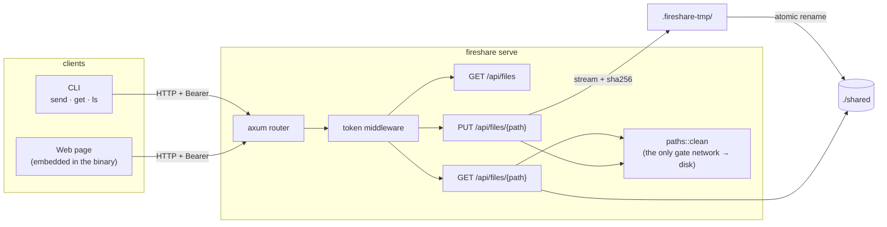

# Design: today and the path to a product

This document explains how fireshare works today and how it was cut to
grow into a product: an interface, a socket and a CLI over the same core.
Anything marked **roadmap** does not exist yet.

## 1. What exists today

| Piece | File | Responsibility |
|---|---|---|
| Path rules | `src/paths.rs` | Accepts plain relative names only; rejects `..`, absolute paths, `\`, NUL and the temp area. Shared by client and server |
| Server | `src/server.rs` | Routes, constant-time token check, streaming upload with hash and size limit, download with hash, listing |
| Client | `src/client.rs` | Upload (sending the hash), recursive folder send, verified download, listing |
| Page | `src/index.html` | Drag and drop, whole folders, progress, download links; nothing to install |
| CLI | `src/main.rs` | `serve`, `send`, `get`, `ls`; every flag also reads a `FIRESHARE_*` variable |

## 2. Protocol

| Route | Auth | Response |
|---|---|---|
| `GET /` | no | Web page |
| `GET /health` | no | `ok` |
| `GET /api/files` | yes | `[{path, size, modified}]`, sorted by `path` |
| `GET /api/files/{path}` | yes | File bytes; `x-content-sha256`, `content-length`, `content-disposition` |
| `PUT /api/files/{path}?overwrite=true` | yes | `201 {path, size, sha256}` |

| Error | When |
|---|---|
| `400` | Invalid path |
| `401` | Missing or wrong token |
| `404` | No such file, or outside the share through a symlink |
| `409` | File exists and `overwrite` was not asked for |
| `413` | Upload above `--max-mib` (discarded) |
| `422` | The SHA-256 sent does not match what arrived (discarded) |

The token goes in `Authorization: Bearer <token>`. For links the browser
opens directly, it is also accepted as `?token=`.

## 3. Guarantees and why they exist

- **Nothing half-written:**
  - An upload is written to `.fireshare-tmp/<random>` and only then renamed. The temp area lives inside the shared directory, so the rename never crosses filesystems and is atomic.
  - A download uses `.<name>.fireshare-part` the same way.
- **Integrity:**
  - The client computes the SHA-256 before sending. The server computes it while streaming and refuses a mismatch.
  - On download, the server announces the hash and the client checks it.
  - The web page sends no hash (the browser's `crypto.subtle` only exists over HTTPS), but it shows the hash the server stored.
- **Confinement:**
  - `paths::clean` is the only way from the network to the disk.
  - Downloads also resolve the real path and require it to stay inside the root, which stops symlinks.
- **Constant memory:** everything streams; no file is ever loaded whole.

## 4. Known limits (today)

| Limit | Consequence | Way forward |
|---|---|---|
| Plain HTTP | Anyone listening on the network sees the content and the token | Built-in TLS (rustls) with a self-signed certificate and its fingerprint printed in the terminal |
| One token for everything | A single device cannot be revoked | Per-device pairing (section 5) |
| A dropped upload starts over | Large files on a bad network | Offset-based resumable upload (section 5) |
| In a container, the printed address is the internal IP | The user has to know the host IP | `--public-url` |
| Two uploads to the same path without `overwrite` can race | The last rename wins | Exclusive create (`link` + `unlink`) if it becomes a requirement |
| The page sends no hash on upload | Browser → server integrity relies on TCP only | Comes with TLS (`crypto.subtle` becomes available) |

## 5. Path to a product (roadmap)

The order below is a proposal. Each step keeps the current protocol
working.

1. **Split into crates** (Cargo workspace), with no behavior change:
   - `fireshare-core`: types, path rules, hashing, protocol.
   - `fireshare-server`: axum, storage behind a `Store` trait (disk today; S3 or others later).
   - `fireshare-client`: the library the CLI and future apps use.
   - `fireshare-cli`: the binary.
2. **Event socket:**
   - `GET /api/events` over WebSocket, with `file.stored`, `file.deleted`, `upload.progress` and `peer.joined` events.
   - The page updates live and the CLI gains `fireshare watch`, which mirrors a folder both ways.
3. **TLS and pairing:**
   - A self-signed certificate generated on first run, with its fingerprint and a QR code in the terminal.
   - Per-device, revocable tokens.
4. **Resumable upload:** `PATCH /api/uploads/{id}` with `Upload-Offset`, tus style. The page and the CLI resume where they stopped.
5. **Discovery:** mDNS (`_fireshare._tcp`), so `fireshare send` finds the server on the network without typing an IP.
6. **Interface:** the current page becomes a SPA served by the binary (folders, preview, history, paired devices). A desktop app (Tauri) reuses `fireshare-client`.
7. **Operations:** `DELETE` and rename, per-device quotas, Prometheus metrics at `/metrics`, JSON logs.

**Rule for evolving:** every step lands with an end-to-end test in
`tests/` and a green `make smoke`; the README numbers only change with a
new measurement.
