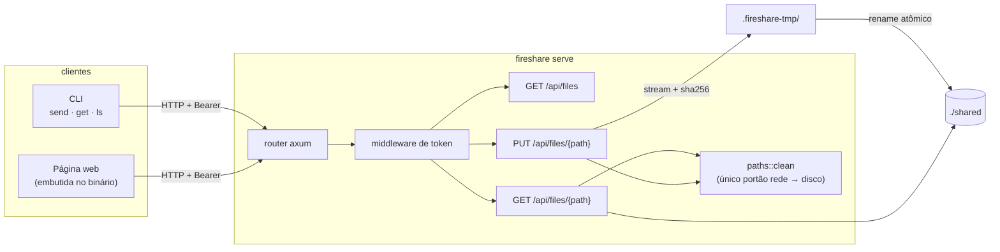

# Design: hoje e o caminho para produto

Este documento explica como o fireshare funciona hoje e como ele foi
cortado para crescer até virar produto: interface, socket e CLI sobre o
mesmo núcleo. O que está marcado como **roadmap** ainda não existe.

## 1. O que existe hoje

| Peça | Arquivo | Responsabilidade |
|---|---|---|
| Regras de caminho | `src/paths.rs` | Aceita só nomes relativos simples; recusa `..`, absoluto, `\`, NUL e a área temporária. É compartilhada por cliente e servidor |
| Servidor | `src/server.rs` | Rotas, token em tempo constante, upload em stream com hash e limite, download com hash, listagem |
| Cliente | `src/client.rs` | Upload (com hash enviado), envio recursivo de pastas, download verificado, listagem |
| Página | `src/index.html` | Arrastar e soltar, pasta inteira, progresso, links de download; não instala nada |
| CLI | `src/main.rs` | `serve`, `send`, `get`, `ls`; toda flag também lê uma variável `FIRESHARE_*` |

## 2. Protocolo

| Rota | Auth | Resposta |
|---|---|---|
| `GET /` | não | Página web |
| `GET /health` | não | `ok` |
| `GET /api/files` | sim | `[{path, size, modified}]`, ordenado por `path` |
| `GET /api/files/{path}` | sim | Bytes do arquivo; `x-content-sha256`, `content-length`, `content-disposition` |
| `PUT /api/files/{path}?overwrite=true` | sim | `201 {path, size, sha256}` |

| Erro | Quando |
|---|---|
| `400` | Caminho inválido |
| `401` | Token ausente ou errado |
| `404` | Arquivo inexistente, ou fora da pasta via symlink |
| `409` | Arquivo já existe e não pediu `overwrite` |
| `413` | Upload acima de `--max-mib` (descartado) |
| `422` | O SHA-256 enviado não bate com o recebido (descartado) |

O token vai em `Authorization: Bearer <token>`. Para links que o navegador
abre direto, também é aceito em `?token=`.

## 3. Garantias e por que existem

- **Nada pela metade:**
  - O upload é escrito em `.fireshare-tmp/<aleatório>` e só depois renomeado. A área temporária fica dentro da pasta compartilhada, então o rename nunca cruza sistemas de arquivo e é atômico.
  - O download usa `.<nome>.fireshare-part` do mesmo jeito.
- **Integridade:**
  - O cliente calcula o SHA-256 antes de enviar. O servidor calcula durante o stream e recusa se não bater.
  - No download, o servidor anuncia o hash e o cliente confere.
  - A página web não manda hash (o `crypto.subtle` do navegador só existe em HTTPS), mas mostra o hash que o servidor gravou.
- **Confinamento:**
  - `paths::clean` é o único caminho entre a rede e o disco.
  - O download ainda resolve o caminho real e exige que ele fique dentro da raiz, o que barra symlinks.
- **Memória constante:** tudo é stream; nenhum arquivo é carregado inteiro.

## 4. Limites conhecidos (hoje)

| Limite | Consequência | Caminho |
|---|---|---|
| HTTP puro | Quem escuta a rede vê o conteúdo e o token | TLS embutido (rustls) com certificado autoassinado e fingerprint mostrado no terminal |
| Um token para tudo | Não dá para revogar um dispositivo só | Pareamento por dispositivo (seção 5) |
| Upload recomeça do zero se cair | Arquivos grandes em rede ruim | Upload retomável por offset (seção 5) |
| No container, o endereço impresso é o IP interno | O usuário precisa saber o IP do host | `--public-url` |
| Corrida entre dois uploads sem `overwrite` no mesmo caminho | O último rename vence | Criação exclusiva (`link` + `unlink`) se virar requisito |
| Página sem hash no upload | Integridade só pelo TCP no caminho navegador → servidor | Vem junto com o TLS (o `crypto.subtle` passa a existir) |

## 5. Caminho para produto (roadmap)

A ordem abaixo é uma proposta. Cada passo mantém o protocolo atual
funcionando.

1. **Separar em crates** (workspace Cargo), sem mudar comportamento:
   - `fireshare-core`: tipos, regras de caminho, hash, protocolo.
   - `fireshare-server`: axum, armazenamento atrás de uma trait `Store` (disco hoje; S3 ou outro depois).
   - `fireshare-client`: a lib que a CLI e futuros apps usam.
   - `fireshare-cli`: o binário.
2. **Socket de eventos:**
   - `GET /api/events` em WebSocket, com eventos `file.stored`, `file.deleted`, `upload.progress` e `peer.joined`.
   - A página atualiza sozinha e a CLI ganha `fireshare watch`, que espelha uma pasta nos dois sentidos.
3. **TLS e pareamento:**
   - Certificado autoassinado gerado na primeira execução, com fingerprint e QR code no terminal.
   - Tokens por dispositivo, revogáveis.
4. **Upload retomável:** `PATCH /api/uploads/{id}` com `Upload-Offset`, no estilo tus. A página e a CLI retomam de onde pararam.
5. **Descoberta:** mDNS (`_fireshare._tcp`), para `fireshare send` achar o servidor na rede sem digitar o IP.
6. **Interface:** a página atual vira uma SPA servida pelo binário (pastas, prévia, histórico, dispositivos pareados). Um app desktop (Tauri) reaproveita o `fireshare-client`.
7. **Operação:** `DELETE` e renomear, cotas por dispositivo, métricas Prometheus em `/metrics`, logs JSON.

**Regra para evoluir:** cada passo entra com teste de ponta a ponta em
`tests/` e com o `make smoke` verde; os números do README só mudam com
medição nova.
